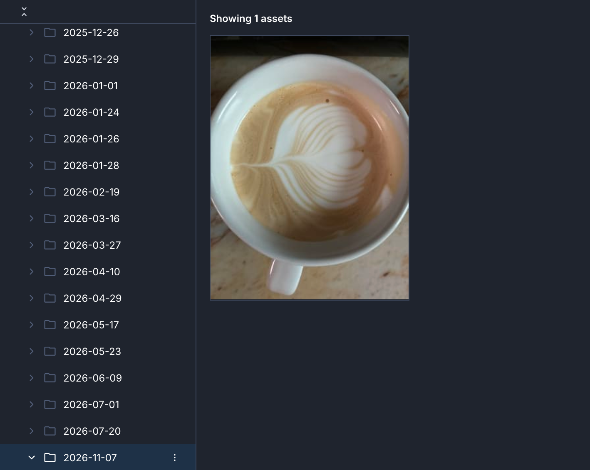

# Day To Day Latte
[Watch Demo Video](https://youtu.be/OyNCSomOTws?si=If4FibIMd5TAis7P)

  

Images uploaded through the Cloudinary Upload Widget are automatically organized into dynamically generated folders based on the current date.